# 1.常用布局控件

##  **Grid（网格布局）**

  - **特点**：通过自定义行（RowDefinitions）和列（ColumnDefinitions）来划分网格，控件可以指定在某行某列中。它是 WPF 中最强大、最常用的布局控件。

## **StackPanel（栈式面板）**
  - **特点**：将子元素按水平方向（Horizontal）或垂直方向（Vertical）排成一条直线。

## **WrapPanel（自动折行面板）**
  - **特点**：子元素按水平或垂直方向顺序排列，当空间不足时会自动折行到下一行或下一列。

## **DockPanel（停靠面板）**
  - **特点**：子元素根据设置停靠在面板的**上、下、左、右**边缘，最后一个子元素（通常设置 `LastChildFill="True"`）可以填充剩余的所有空间。 

## **UniformGrid（均布网格）**
  - **特点**：所有网格单元格的大小完全均等，不需要手动设置行高和列宽，系统会自动平均分配。

## **Canvas（画布）**
  - **特点**：使用显式的坐标（通过 `Canvas.Left`、`Canvas.Top` 等附加属性）来精确定位子元素，类似于 WinForms 的绝对定位。 

## **ScrollViewer（滚动条视图）**
  - **特点**：当子内容超出容器可视区域时，为其提供水平或垂直滚动条支持（常与其他布局控件嵌套使用）。

## **Viewbox（缩放框）**
  - **特点**：自动对包含的子元素进行等比例缩放，使内容能够完全适应容器的大小。 

## **Border（边框容器）**
  - **特点**：主要用于给单个子元素绘制边框、背景色或设置圆角（通常也归类为辅助布局/装饰容器）。

# 2.Grid控件学习

## 2.1定义行和列

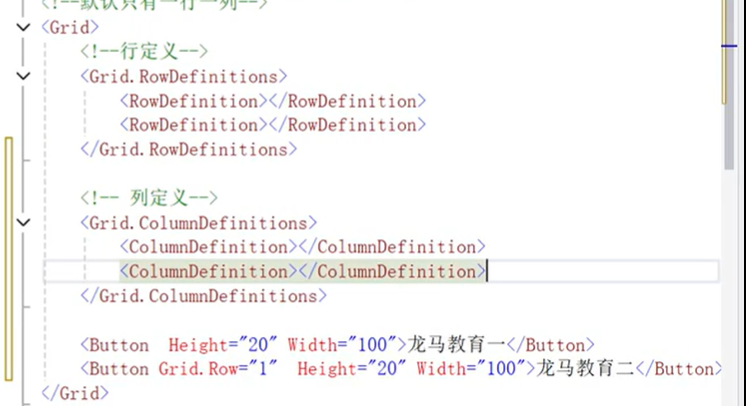

## 2.2给控件指定行和列，第1行第一列可以不写，因为他是默认值

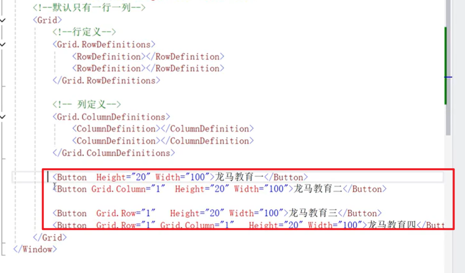

## 注意，不能够把多个控件直接放到MainWindow里面，需要一个面板对象作为window的内容元素，然后其它控件作为面板的子元素。也不能把一个控件放在面板元素外面

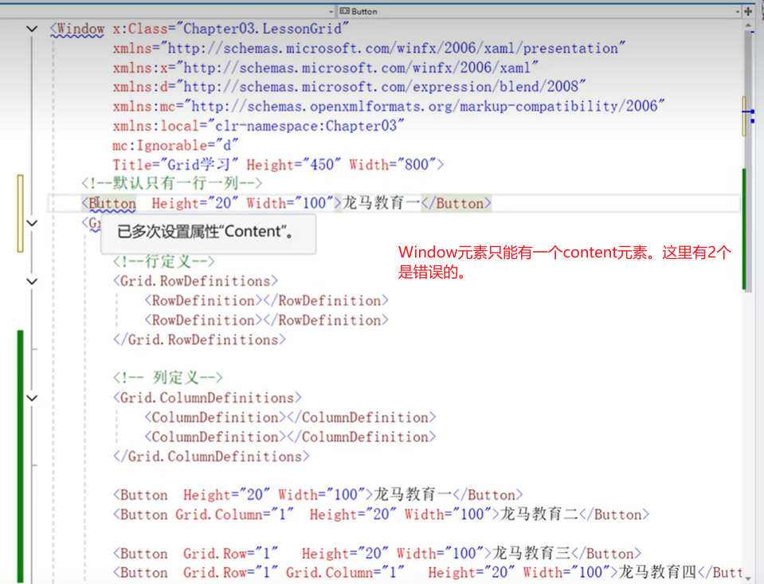

## 2.2 行高的设置，`Grid` 的行高通过 `RowDefinition` 的 `Height` 属性进行设置，主要分为三种模式：**固定高度**、**自动调整（Auto）**和**比例分配（Star, \*）**

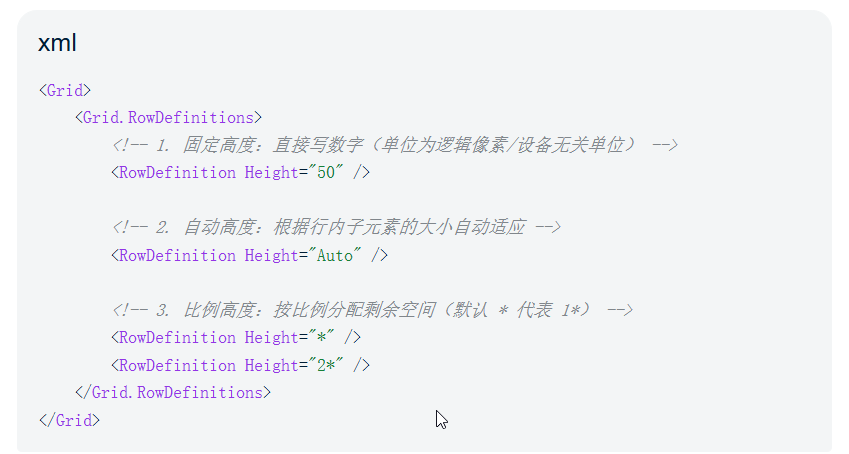

### 注意：列宽也是一样的设置方法，如果一个Grid有n行，有固定高度也有比例高度，是先分配给固定高度的行，剩余的高度再按比例分配。

## 2.3.让Grid显示网格线

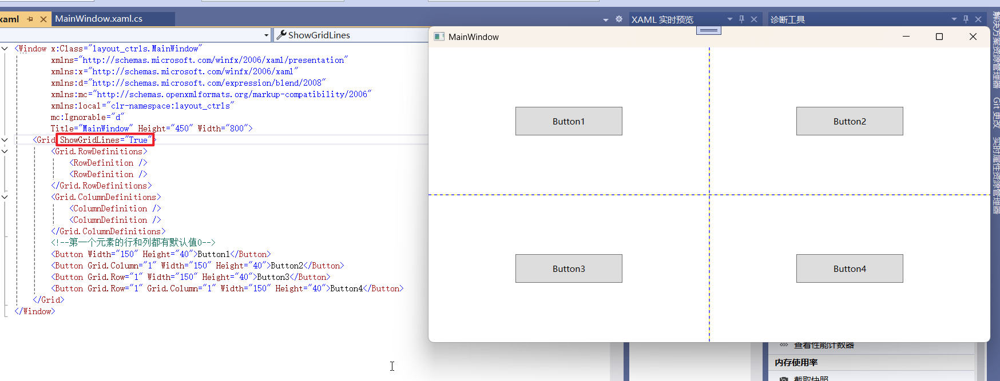


## 2.4，Grid中控件的跨行通过Grid.RowSpan设置，跨列通过Grid.ColumnSpan的设置

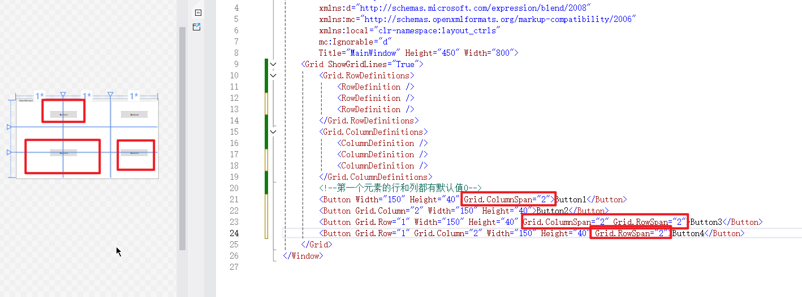

## 演练1.创建一个项目layout-ctrls，然后在MainWindow中输入下面的代码

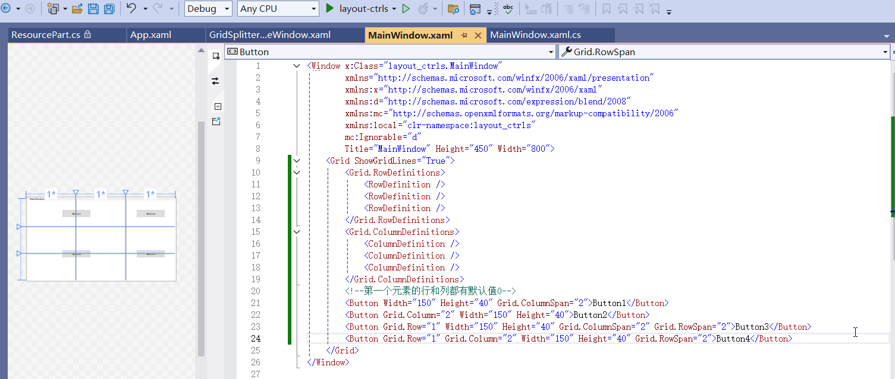

### 运行程序，效果如下

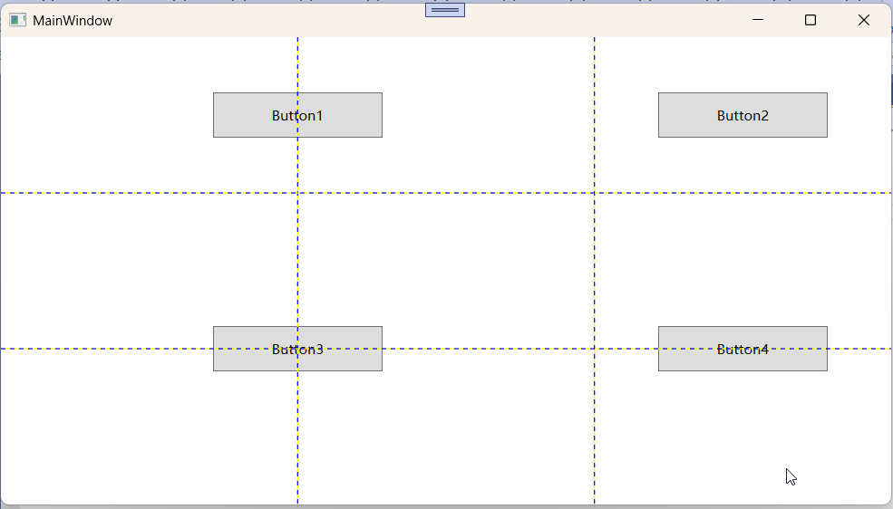


# 3.GridSplitter的使用

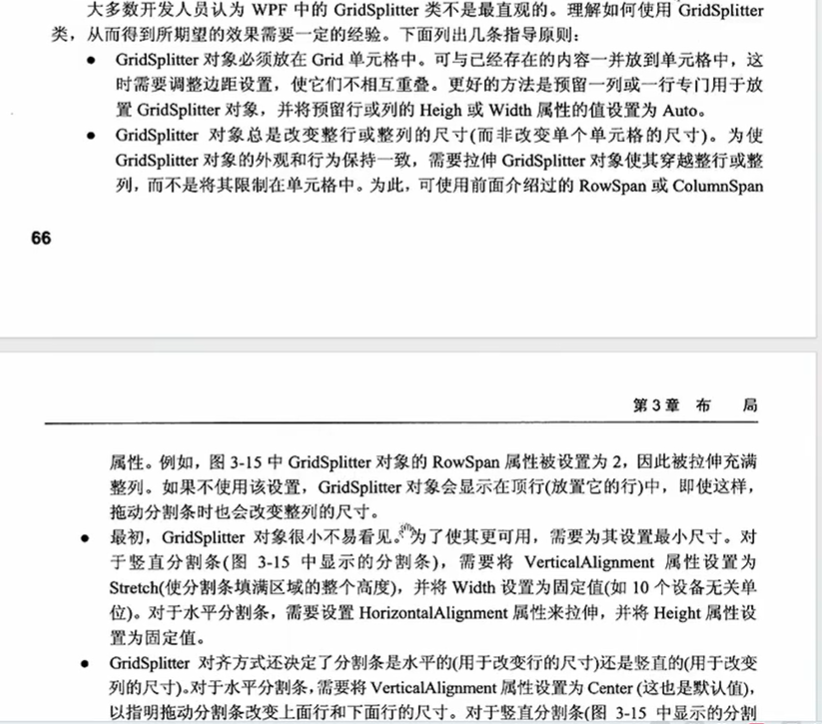

## 参考文档：https://www.cnblogs.com/guxin/p/csharp-wpf-how-to-use-gridsplitter.html

***\*GridSplitter\**** 是 WPF 中用于在 `Grid` 布局的行或列之间提供**动态拖拽调整大小**的控件。用户在运行时可以通过鼠标拖动分割线来改变相邻行或列的宽度或高度。

------

### 核心使用规则与方向

1. 调整“列”（左右分割）

- **放置位置**：将 `GridSplitter` 放在某一个**列**中（通常单独占用一列，宽度设为固定值如 `Width="5"`）。 [[1](https://www.cnblogs.com/guxin/p/csharp-wpf-how-to-use-gridsplitter.html)]
- **尺寸模式**：与其相邻的列宽度不能仅用 `Auto`，最好使用 `*`（星号比例）或固定数值。
- **关键属性**：
  - 设置 `VerticalAlignment="Stretch"`（让分割线垂直方向拉满）。
  - 设置 `HorizontalAlignment="Center"` 或 `Stretch`。
  - 如果 `Grid` 有多行，通常需要设置 `Grid.RowSpan="行数"` 以覆盖整个高度。 [[1](https://www.cnblogs.com/guxin/p/csharp-wpf-how-to-use-gridsplitter.html)]

**示例代码（左右分割）：**

xml

```
<Grid>
    <Grid.ColumnDefinitions>
        <ColumnDefinition Width="200" />
        <ColumnDefinition Width="5" />
        <ColumnDefinition Width="*" />
    </Grid.ColumnDefinitions>

    <!-- 左侧内容 -->
    <TextBlock Text="左侧面板" Grid.Column="0" Background="LightBlue"/>

    <!-- 垂直分割线 -->
    <GridSplitter Grid.Column="1" Width="5" HorizontalAlignment="Center" VerticalAlignment="Stretch" Background="Gray"/>

    <!-- 右侧内容 -->
    <TextBlock Text="右侧面板" Grid.Column="2" Background="LightGreen"/>
</Grid>
```

 

2. 调整“行”（上下分割）

- **放置位置**：将 `GridSplitter` 放在某一个**行**中（通常单独占一行，高度设为固定值如 `Height="5"`）。
- **尺寸模式**：相邻行高度建议使用 `*` 或固定值。
- **关键属性**：
  - 设置 `HorizontalAlignment="Stretch"`（让分割线水平方向拉满）。
  - 设置 `VerticalAlignment="Center"` 或 `Stretch`。
  - 如果 `Grid` 有多列，通常需要设置 `Grid.ColumnSpan="列数"` 以跨越所有列。

**示例代码（上下分割）：**

xml

```
<Grid>
    <Grid.RowDefinitions>
        <RowDefinition Height="*" />
        <RowDefinition Height="5" />
        <RowDefinition Height="150" />
    </Grid.RowDefinitions>

    <!-- 上方内容 -->
    <TextBlock Text="上方区域" Grid.Row="0" Background="LightYellow"/>

    <!-- 水平分割线 -->
    <GridSplitter Grid.Row="1" Height="5" HorizontalAlignment="Stretch" VerticalAlignment="Center" Background="Gray"/>

    <!-- 下方内容 -->
    <TextBlock Text="下方区域" Grid.Row="2" Background="LightCoral"/>
</Grid>
```

常见避坑指南

1. **拖不动或无效**：
   - 检查是否遗漏了对齐属性：调整列宽时必须设置 `VerticalAlignment="Stretch"`；调整行高时必须设置 `HorizontalAlignment="Stretch"`。
   - 检查 `Width` 或 `Height` 是否漏写（如左右分割时忘写 `GridSplitter` 的 `Width`）。 [[1](https://www.cnblogs.com/guxin/p/csharp-wpf-how-to-use-gridsplitter.html)]
2. **跨行/跨列覆盖**：
   - 如果 `Grid` 结构复杂（有多行多列），务必配置 `Grid.RowSpan` 或 `Grid.ColumnSpan`，否则 `GridSplitter` 可能只在一个小格子中缩成一个小方块。 [[1](https://learn.microsoft.com/zh-cn/dotnet/desktop/wpf/controls/how-to-resize-rows-with-a-gridsplitter), [2](https://learn.microsoft.com/zh-cn/dotnet/desktop/wpf/controls/how-to-resize-columns-with-a-gridsplitter)]
3. **视觉不明显**：
   - 默认的 `GridSplitter` 是透明的或很不显眼，建议为其设置 `Background="Gray"` 或者通过 `Template` 自定义好看的拖拽样式。

## 演练GridSplitter

### 1》还是上面的项目，新建一个wpf窗口，起名：GridSplitterExampleWindow.xaml，并且在App.xaml中把它设置为启动窗口

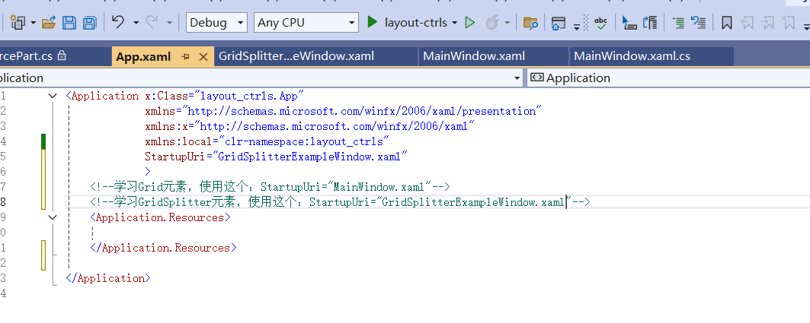

#### 启动程序，应该显示一个空白窗口，标题是GridSplitterExampleWindow

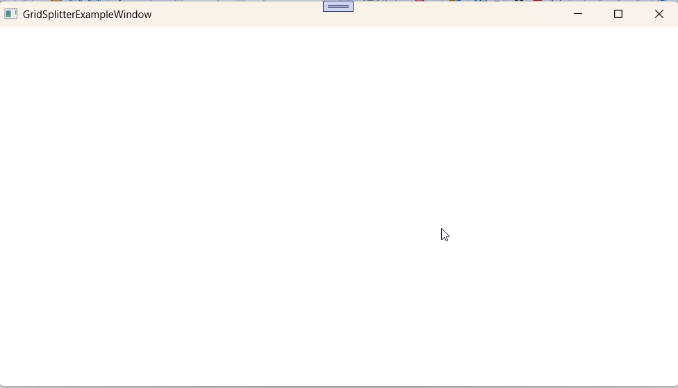

### 2》把Grid划分3列

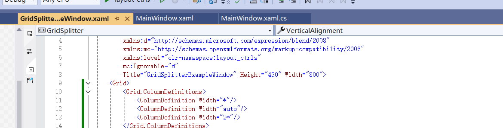

### 3.然后添加一些代码，修改后的代码如下

```
<Window x:Class="layout_ctrls.GridSplitterExampleWindow"
        xmlns="http://schemas.microsoft.com/winfx/2006/xaml/presentation"
        xmlns:x="http://schemas.microsoft.com/winfx/2006/xaml"
        xmlns:d="http://schemas.microsoft.com/expression/blend/2008"
        xmlns:mc="http://schemas.openxmlformats.org/markup-compatibility/2006"
        xmlns:local="clr-namespace:layout_ctrls"
        mc:Ignorable="d"
        Title="GridSplitterExampleWindow" Height="450" Width="800">
    <Grid Cursor="">
        <Grid.ColumnDefinitions>
            <ColumnDefinition Width="*"/>
            <ColumnDefinition Width="auto"/>
            <ColumnDefinition Width="2*"/>
        </Grid.ColumnDefinitions>
        <TextBlock TextWrapping="WrapWithOverflow" FontSize="16" Foreground="DeepPink" >
            好好学习，天天向上 好好学习，天天向上 好好学习，天天向上 好好学习，天天向上 好好学习，天天向上好好学习，天天向上 好好学习，天天向上 好好学习，天天向上 好好学习，天天向上 好好学习，天天向上 好好学习，天天向上
        </TextBlock>
        <GridSplitter Grid.Column="1" Width="5" HorizontalAlignment="Center" VerticalAlignment="Stretch"/>
        <WrapPanel Grid.Column="2">
            <TextBlock FontSize="16">恭喜发财，红包拿来</TextBlock>
            <TextBlock FontSize="16">恭喜发财，红包拿来</TextBlock>
            <TextBlock FontSize="16">恭喜发财，红包拿来</TextBlock>
            <TextBlock FontSize="16">恭喜发财，红包拿来</TextBlock>
            <TextBlock FontSize="16">恭喜发财，红包拿来</TextBlock>
            <TextBlock FontSize="16">恭喜发财，红包拿来</TextBlock>
            <TextBlock FontSize="16">恭喜发财，红包拿来</TextBlock>
            <TextBlock FontSize="16">恭喜发财，红包拿来</TextBlock>
            <TextBlock FontSize="16">恭喜发财，红包拿来</TextBlock>
            <TextBlock FontSize="16">恭喜发财，红包拿来</TextBlock>
            <TextBlock FontSize="16">恭喜发财，红包拿来</TextBlock>
            <TextBlock FontSize="16">恭喜发财，红包拿来</TextBlock>
            <TextBlock FontSize="16">恭喜发财，红包拿来</TextBlock>
            <TextBlock FontSize="16">恭喜发财，红包拿来</TextBlock>
            <TextBlock FontSize="16">恭喜发财，红包拿来</TextBlock>
            <TextBlock FontSize="16">恭喜发财，红包拿来</TextBlock>
            <TextBlock FontSize="16">恭喜发财，红包拿来</TextBlock>
            <TextBlock FontSize="16">恭喜发财，红包拿来</TextBlock>
            <TextBlock FontSize="16">恭喜发财，红包拿来</TextBlock>
        </WrapPanel>
    </Grid>
</Window>

```

#### 需要注意，必须正确设置GridSplitter的水平对齐和垂直对齐，否则效果不好

### 4.运行程序，效果如下，还是不错的

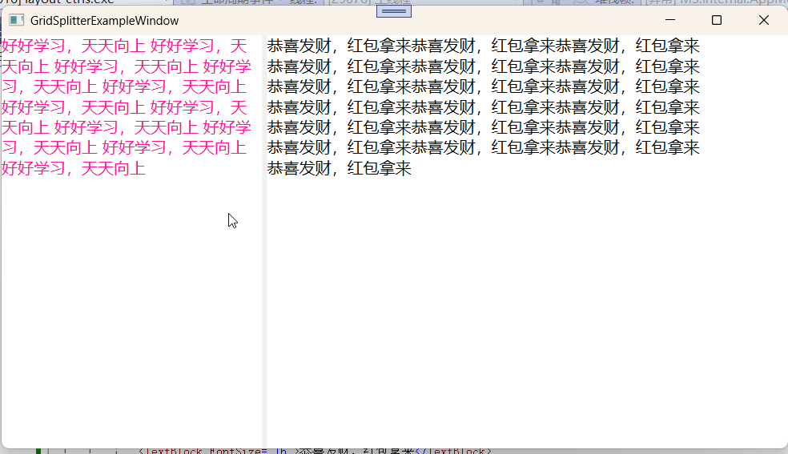

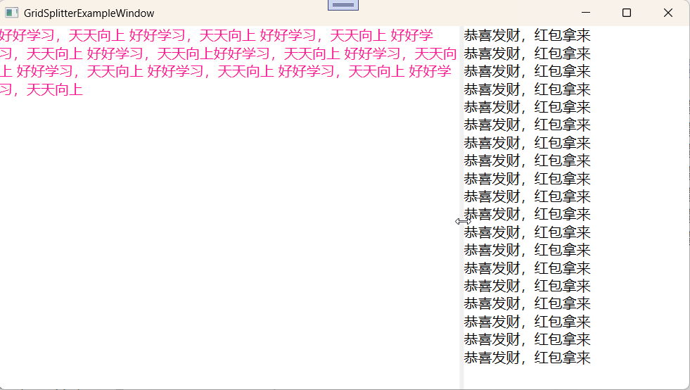

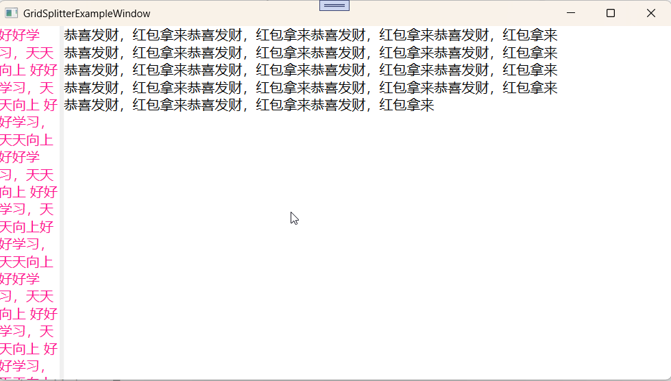

